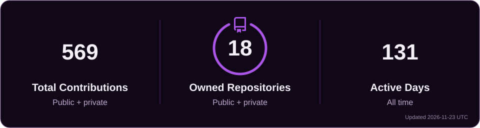
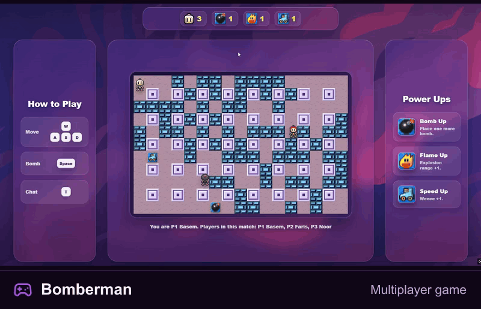
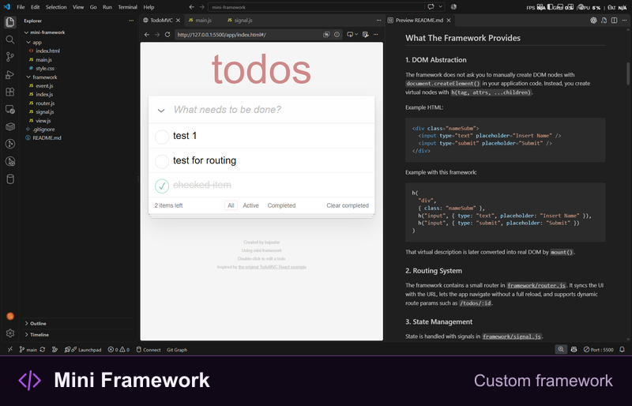

<h1 align="center">
  
  Basem Mohamed
</h1>

  <strong>Z01 &middot; UOB</strong>

<h3 align="center"><em>Computer Science &amp; Software Engineering Student</em></h3>

  

---

<h2> Project Showcase</h2>

<table>
  <tr>
    <td width="50%"></td>
    <td width="50%"></td>
  </tr>
  <tr>
    <td width="50%"></td>
    <td width="50%"></td>
  </tr>
</table>
